# ORVYN

**Your money, one step ahead.**

ORVYN is a mobile bank that doesn't exist. It's a portfolio project: an Android app, its server and an admin website, built to feel like a real Indonesian bank for people like an OCBC customer in Jakarta. All money is pretend and nothing connects to real banks, QRIS or billers, but every rupiah moves through a proper double-entry ledger, and testers use it on their own phones.

<p>
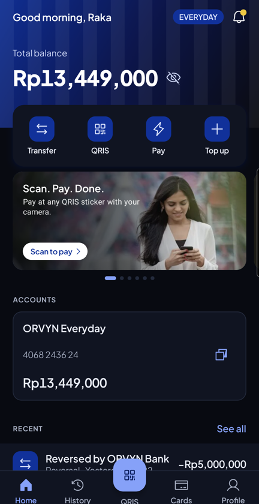
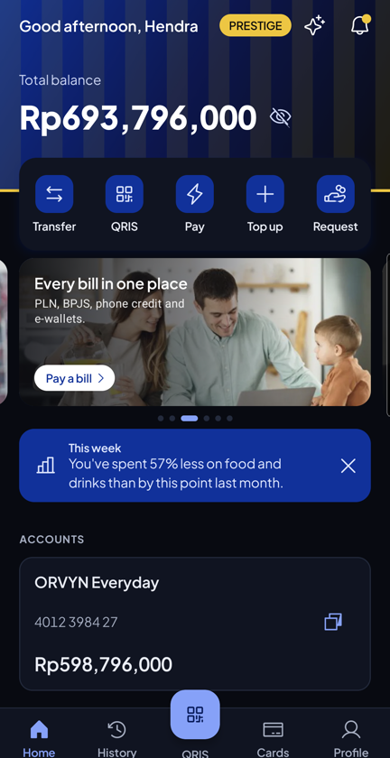
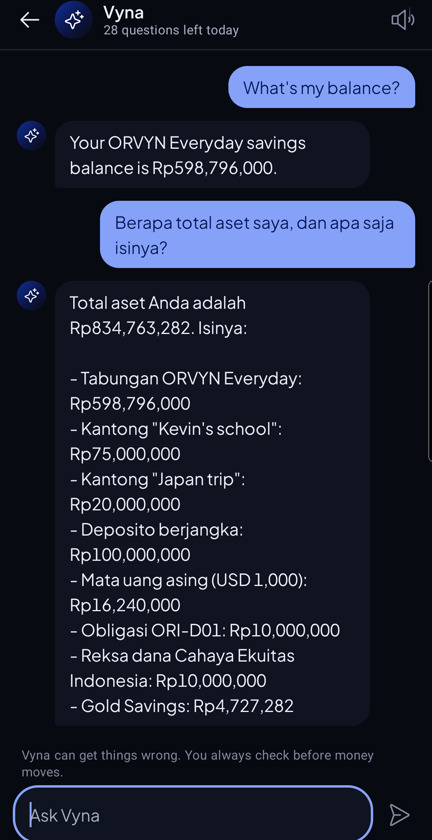
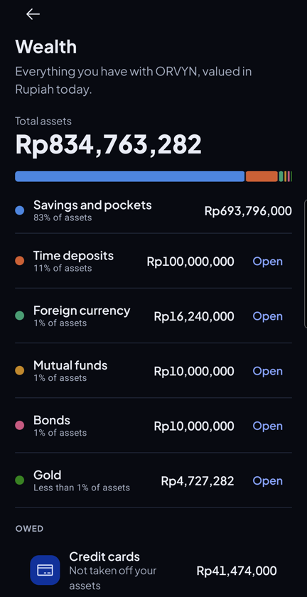
</p>
<p>
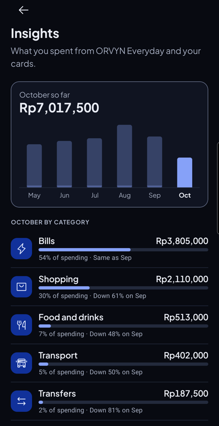
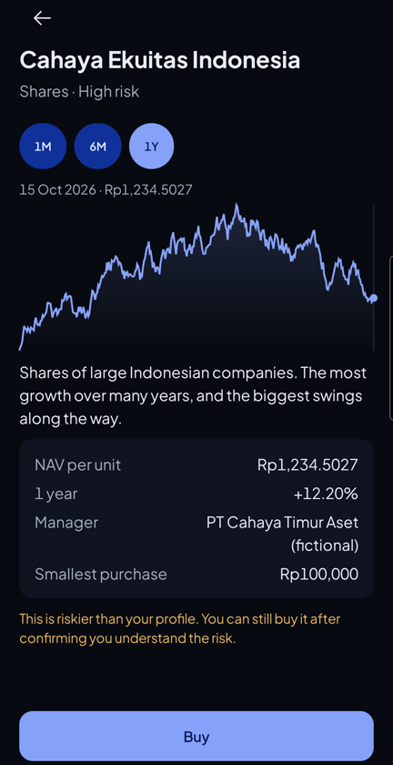
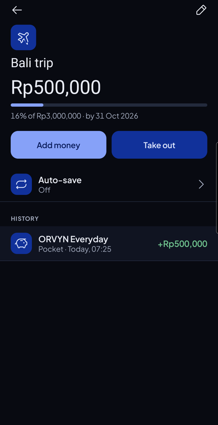
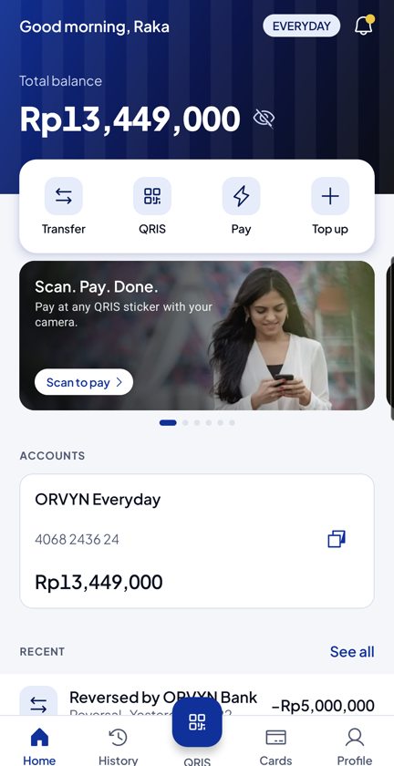
</p>

## What it does

**Everyday banking**
- Open an account from the app: phone number with a code, details, KTP photo and selfie (they never leave the phone), password and PIN, then an officer approves it.
- Transfers to other ORVYN customers (free) and to 14 other banks by BI-FAST or RTGS, with saved recipients, daily limits and a PIN for every payment.
- QRIS: scan a code with the camera or from a screenshot, and show your own code to get paid.
- Pay bills: PLN tokens and bills, BPJS, phone credit, e-wallet top-ups.
- Debit and credit cards: freeze, online/overseas/contactless switches, daily limits, card details behind a PIN on a screen that can't be captured, paying the card bill.
- Push notifications for money in and out, with only "New activity" on the lock screen.

**Helping you manage money**
- **Vyna**, an AI assistant on Claude Haiku 5.5. She answers in English or Bahasa Indonesia from your own data, and can get a transfer or a pocket move ready for you to review. She never moves money herself.
- Pockets with goals and auto-save (a share of salary, a weekly amount, or rounding up payments).
- Scheduled and repeating transfers, money requests and split bills.
- Insights by category against the same days last month, budgets with reminders, a weekly insight card.
- Monthly e-statements as PDF, made on the phone. A home screen widget.

**Growing it**
- Foreign currency accounts (USD, SGD, EUR, JPY, AUD) with buy and sell rates set by officers.
- Time deposits for 1 to 12 months, with interest after tax and renew or pay out at maturity.
- A risk profile quiz, mutual funds whose prices move every day, retail government bonds with a monthly coupon, and gold by the gram.
- One Total Assets number with its breakdown.
- Prestige tier with gold touches, better exchange rates and a Relationship Manager.
- Passkey sign-in.

**Admin website** for officers: create test customers from personas, add money that looks real, approve applications, reverse transactions, run merchants, banners and messages, set limits, fees, rates and feature switches, see what Vyna costs, and reset the demo.

<p>
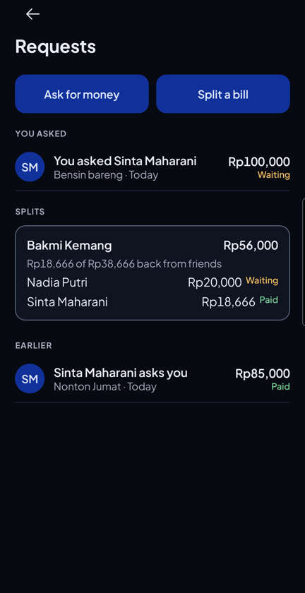
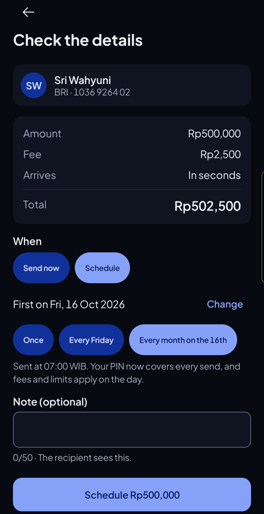
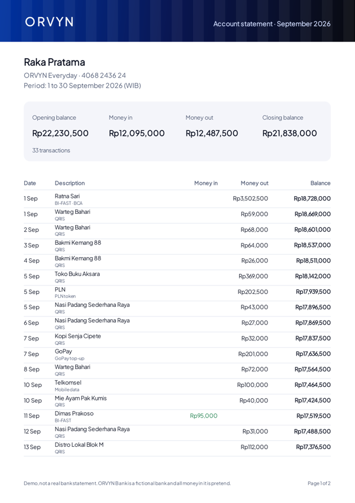
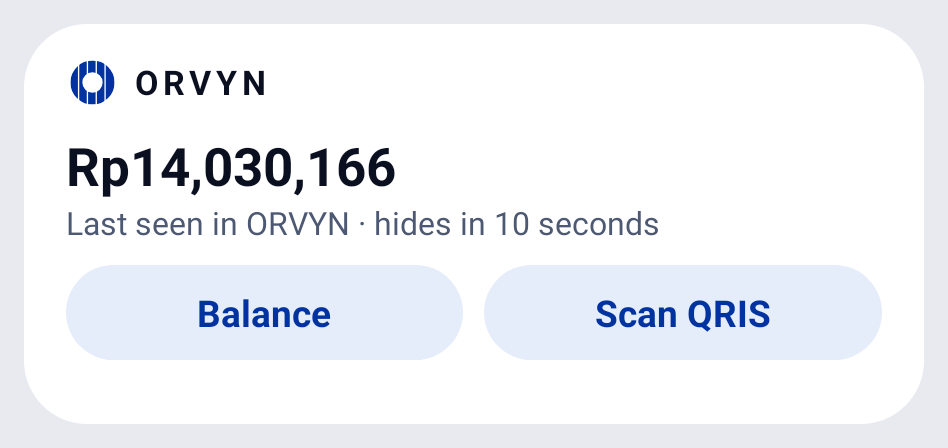
</p>

## How it's built

| Part | Technology |
|---|---|
| Android app | Kotlin, Jetpack Compose, Material 3. No image or networking libraries: `HttpURLConnection`, `org.json` and Canvas. CameraX and ZXing for QR, Credential Manager for passkeys, Firebase Cloud Messaging for push. |
| Server | Node 22 running TypeScript directly, Hono, PostgreSQL. Server-rendered admin with `hono/html`. |
| AI | Claude Haiku 5.5 through the Anthropic SDK, with read-only tools scoped to the signed-in customer, streamed to the app over server-sent events, prompt caching on. |
| Hosting | A home server behind a Cloudflare Tunnel, Docker Compose, nightly database backups. |

The pieces worth a look:

- **A double-entry ledger** ([ADR 0001](docs/adr/0001-double-entry-ledger.md)). Every balance change is a journal entry whose postings add up to zero in each currency. Pockets, deposits, FX accounts and credit cards are ordinary accounts in it. Balances are a cache checked against the postings after every entry and every night.
- **No device data** ([ADR 0002](docs/adr/0002-no-device-data.md)). The app can't read contacts, location, SMS or files, and the build fails if a permission outside the approved list appears. Speech recognition for Vyna only runs on the phone.
- **Investments outside the ledger** ([ADR 0003](docs/adr/0003-holdings-outside-the-ledger.md)). Fund units and grams of gold change value daily without money moving, so holdings are tracked in units and only the Rupiah side goes through the ledger.
- **Idempotency everywhere money moves.** A double tap or a retry after a timeout returns the original transaction instead of paying twice.

## Quality

- 92 server tests against a real PostgreSQL database, covering the ledger, transfers, pockets, scheduled transfers, requests, insights, FX, deposits, investments and passkeys (with a software authenticator).
- Screenshot tests of the app in light and dark, and a Robolectric test of the widget.
- An evaluation set of 30 questions for Vyna on a known customer: 30 of 30 correct, for about half a US cent per run (`npm run eval:vyna`).
- Every flow except the widget was tried on a Galaxy Note10+ before release.

## Running it

```bash
# Database for development
docker compose -f compose.dev.yaml -p orvyn-dev up -d

# Server (applies migrations, then serves the API on :8790 and the admin at /admin)
cd server && npm install
ADMIN_EMAIL=you@example.com ADMIN_PASSWORD=change-me PORT=8790 node src/main.ts
npm test

# App: a debug build talks to the local server through `adb reverse tcp:8790 tcp:8790`
cd android && ./gradlew assembleDebug
```

Optional: `ANTHROPIC_API_KEY` turns on Vyna, `FIREBASE_SERVICE_ACCOUNT` plus `secrets/google-services.json` turn on push.

## Read more

- [The story of the project](docs/STORY.md)
- [Product requirements](PRD-ORVYN.md) (Indonesian) and [user stories](docs/stories/)
- [Domain glossary](CONTEXT.md) and [design system](design-system/MASTER.md)

ORVYN Bank, its people, merchants, funds and bonds are made up. Any resemblance to a real bank is a compliment.
